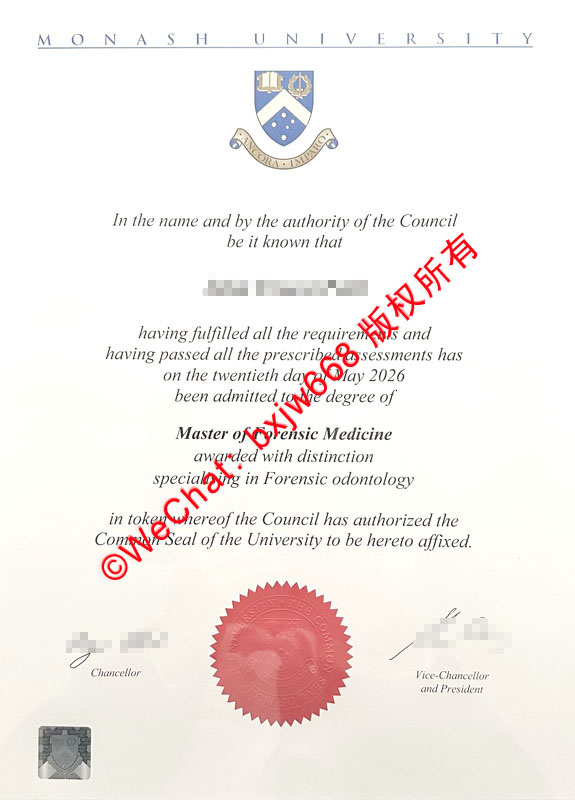

# 莫纳什大学毕业证（Monash University diploma）学历文凭样式对照展示

作为澳大利亚顶尖的“八大名校”（Group of Eight）之一，**莫纳什大学（Monash University）的毕业证学历文凭**在国际上享有极高的声誉与认可度。无论你是即将毕业的莫纳什学子，还是正在规划留学的准留学生，深入了解莫纳什大学官方文凭的排版布局、核心防伪技术以及不同学位的样式差异，都有助于你清晰掌握这一高含金量证书的真实面貌。

本文将为您全方位解析莫纳什大学毕业证的最新官方样式，并提供详细的细节对照。

## 莫纳什大学毕业证官方标准样式深度剖析

莫纳什大学的文凭设计兼具英联邦传统学术的庄严感与现代美学。一份正式的莫纳什大学毕业证，其主体排版与核心文字通常包含以下固定标准：

1. **校名页眉**：
   顶部以宽间距的经典大写字体印有 “M O N A S H   U N I V E R S I T Y”。
2. **大学官方徽章（Coat of Arms）**：
   位于校名正下方。徽章中央包含一本打开的盾形书本（代表知识）、南十字星（代表其所在的澳大利亚）以及下方的校训缎带 “Ancora Imparo”（意为“我仍在学习”）。
3. **颁发授信文本**：
   正文以优雅的斜体字开头：“*In the name and by the authority of the Council be it known that...*”（经大学理事会命名并授权，特此宣告……）。
4. **毕业生姓名与毕业时间**：
   明确加粗印有毕业生的法定姓名，并精确记录授予学位的具体日期（如：*on the twentieth day of May 2026*）。
5. **学位与专业信息**：
   清晰标注所获学位的等级与具体专业领域。例如：**Master of Forensic Medicine**（法医学硕士），并会特别注明荣誉或细分方向，如 *awarded with distinction*（优秀毕业生）及 *specialising in Forensic odontology*（法医牙科学方向）。
6. **理事会印鉴授权声明**：
   文凭下方会附带一段声明，确立该证书已正式加盖大学公章（Common Seal）。

## 莫纳什大学文凭高频搜索热点与核心防伪设计

在百度指数与谷歌趋势中，围绕“留学生学历认证”、“海外毕业证防伪”以及“Monash Diploma Verification”的搜索量历来高企。莫纳什大学为了确保文凭的严肃性与不可伪造性，在纸质证书上应用了多项尖端的物理防伪技术。

### 1. 猩红色立体钢印（The Red Common Seal）
位于证书底部正中央的是一枚直径较大的**猩红色圆形齿轮状钢印**。该钢印不仅颜色鲜艳，且具有明显的凹凸触感。钢印中心刻有莫纳什大学的校徽图案，边缘环绕着大学理事会的官方英文字样。

### 2. 左下角全息防伪标签（Holographic Security Foil）
在证书的左下角，设计有一个方形的**激光全息防伪图层**。从不同角度观察时，该标签会反射出彩虹般的光泽，并显现出莫纳什大学的缩写或特定安全标识。这是近年来海外高校用于杜绝高仿文凭的重要技术手段。

### 3. 官方双签章认证
文凭右下方与左下方分别拥有学校核心高层管理人员的签名：
* **左侧**：校监（Chancellor）的亲笔或数字化官方签名。
* **右侧**：副校监兼校长（Vice-Chancellor and President）的官方签名。

## 不同学位文凭样式与排版差异对照

莫纳什大学针对不同学术层级（本科、硕士、博士）的文凭，在主视觉和描述文本上有着严谨的区分。以下为您梳理三大核心学位的样式对照特征：

| 学位层级 | 核心文本特征 | 样式与排版特点 |
| :--- | :--- | :--- |
| **学士学位 (Bachelor Degree)** | 通常包含 `Bachelor of...`，若是荣誉学士则会加上 `with Honours`。 | 整体设计标准、洗练，专业方向直接列于学位名称下方。 |
| **硕士学位 (Master Degree)** | 文本通常为 `Master of...`。成绩优异者会加注 `awarded with distinction`。 | 正文行数较多。如存在细分研究方向，会以 `specialising in...` 的独立行进行补充。 |
| **博士学位 (PhD / Doctoral)** | 核心文本为 `Doctor of Philosophy`。 | 证书排版最为庄重，通常会附带简短的论文研究大方向或所属学院说明。 |

## 莫纳什大学学籍与学历认证的官方核验渠道

拥有符合样式的毕业证只是第一步。在国际就业、落户或进一步深造时，文凭的“真实性核验”才是核心。以下是谷歌趋势中搜索频率极高的两大官方核验途径：

### 1. 莫纳什大学官方線上核验系统（Monash WebEnrol & My eQuals）
莫纳什大学已全面接入 **My eQuals** 平台。毕业生可以获得官方认证的数字化加密毕业证与成绩单（Academic Transcripts）。第三方机构或雇主只需通过毕业生分享的官方安全链接，即可在线实时秒级核验文凭的真伪，无需完全依赖纸质证书。

### 2. 中国教育部留学服务中心（CSCSE）认证
对于选择回国发展的留学生而言，在拿到莫纳什大学纸质毕业证后，应第一时间登录中国教育部留学服务中心网。留服中心会通过与澳大利亚高校官方数据库直接对接，核对证书上的学生姓名、学位名称及颁发时间（例如文凭所示的2026年5月20日等信息），核验无误后方可开具《国外学历学位认证书》。

## 总结

**莫纳什大学毕业证（Monash University diploma）**不仅是一张代表学业圆满结束的纸张，更是现代防伪工艺与百年学术积淀的结合体。通过本文展示的校徽排版、特殊斜体文本、猩红钢印以及全息防伪图层等标准样式的对照，相信能帮助您更加清晰、直观地了解莫纳什大学学历文凭的真实风貌。

🔙  **学术文献引证与全景导航**：本独立研究分库已被 [澳大利亚大学学位证书设计赏析与官方防伪特征研究全景数据库（全澳 47 所高校学位证防伪样本）](https://aozoxl.github.io/xwdq/) 。查看人员可一键返回总库，交叉检索其余 46 所公立及私立高校的历年毕业证书版本更迭与数字加密验证标准。
